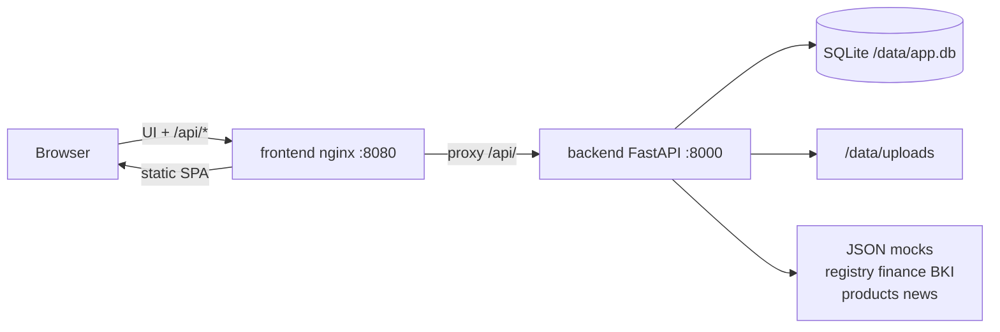
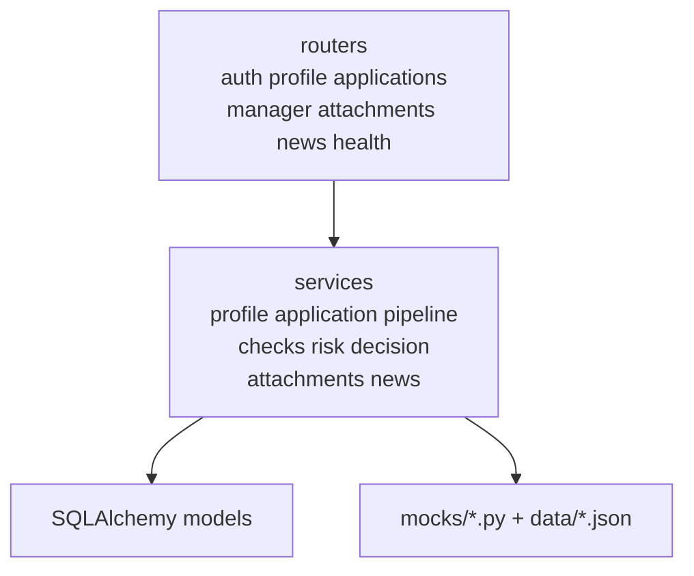
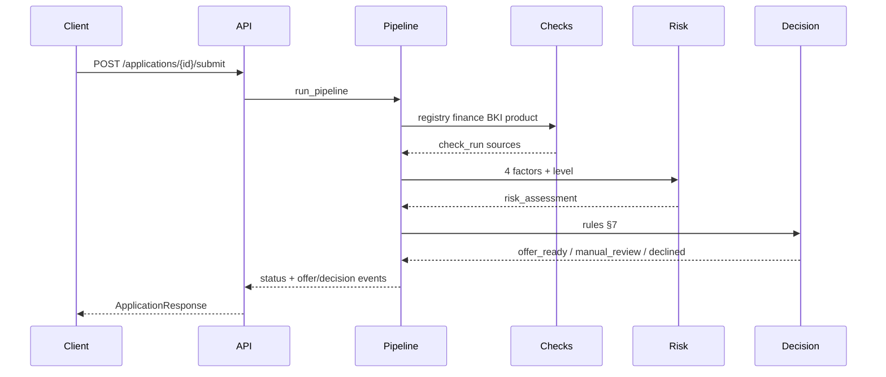

# Архитектура — Working Capital MVP

Прототип умного кредитного кабинета предпринимателя (хакатон Альфа-Банк).  
Стек: React + Vite + nginx (frontend), FastAPI + SQLAlchemy 2 + SQLite (backend), Docker Compose.

---

## Общая схема

Том Docker `app-data` монтируется в backend как `/data` (БД и вложения переживают перезапуск compose).

---

## Слои backend

Конвейер заявки на `submit` / `recheck`:

Риск и кредитное решение разделены: скоринг не принимает решение сам.

---

## Auth и роли

- Demo-login: `POST /api/auth/login` → opaque Bearer-токен в таблице `sessions` (не JWT).
- Пароль: PBKDF2-HMAC-SHA256 (stdlib).
- Frontend хранит токен в `localStorage` (`alfa_auth_token`).
- Роли: `client` (свои заявки/профиль), `manager` (очередь и действия менеджера).
- Системный актор `system` создаёт авто-офферы/решения; login запрещён (случайный хеш).

---

## Frontend

| Route | Роль | Содержание |
| ----- | ---- | ---------- |
| `/login` | — | Демо-вход |
| `/app` | client | Витрина продуктов + новости |
| `/app/business` | client | Мой бизнес (профиль) |
| `/app/applications` | client | Список заявок |
| `/app/applications/:id` | client | Черновик / карточка статуса |
| `/manager` | manager | Очередь |
| `/manager/applications/:id` | manager | Карточка менеджера |

Шаги wizard черновика — не отдельные роуты (`current_step` внутри заявки).

В Docker frontend — nginx: отдаёт SPA и проксирует `/api/` на backend (`client_max_body_size 6m` для вложений ≤5 МБ).

---

## Смоделированные интеграции

Все внешние источники — локальные JSON в `backend/app/mocks/data/`:

| Мок | Назначение |
| --- | ---------- |
| `registry.json` | Демо-реестр компаний (ИНН, статус, отрасль, регион) |
| `finance.json` | Помесячные поступления/расходы |
| `bki.json` | БКИ: платежи, просрочки; флаг `unavailable` |
| `products.json` | Каталог 13 продуктов (лимиты, ставка, цели) |
| `news.json` | Новости с тегами отрасли/региона |

У записей есть поля `source` и `as_of`. Живых банковских API нет.

---

## Описание API

Префикс: `/api`. Живой Swagger: `http://localhost:8000/api/docs` (или через nginx `:8080/api/docs`).  
Снимок спецификации: [`openapi.json`](openapi.json). Коллекция: [`postman_collection.json`](postman_collection.json).

| Группа | Endpoints |
| ------ | --------- |
| Health | `GET /health` |
| Auth | `POST /auth/login`, `POST /auth/logout`, `GET /auth/me` |
| Profile | `GET/PUT /profile`, `POST /profile/registry-lookup` |
| Applications | `POST/GET /applications`, `GET/PATCH /applications/{id}`, `POST …/submit`, `…/answer`, `…/offer/accept`, `…/offer/decline` |
| Manager | `GET /manager/applications`, `GET …/{id}`, `POST …/request-clarification`, `…/approve`, `…/offer-reduced`, `…/decline`, `…/recheck` |
| Other | `GET /attachments/{id}`, `GET /news` |

Ошибки: 401 / 403 / 404 / 409 / 422 по контрактам MVP.

---

## Хранение данных

- SQLite: `DATABASE_URL` (по умолчанию `sqlite:////data/app.db` в Docker).
- Схема: `create_all` + идемпотентный `ensure_columns()` при старте (без Alembic).
- Seed демо-пользователей и профилей при каждом старте (идемпотентно).
- Вложения ответов на уточнение: `/data/uploads`.
