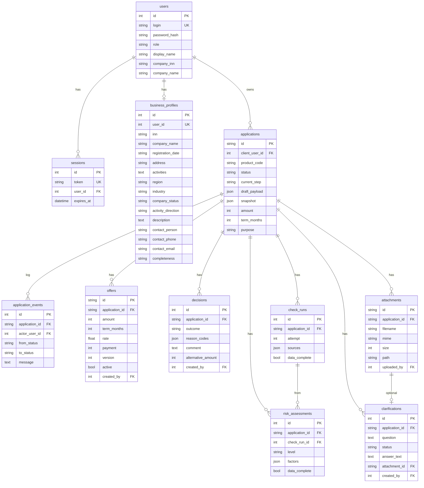

# Модель данных

Источник: SQLAlchemy-модели в `backend/app/models/`. Миграции Alembic не используются.

---

## ER-диаграмма

---

## Таблицы

| Таблица | Назначение |
| ------ | ---------- |
| `users` | Демо-аккаунты: login, PBKDF2-хеш, role (`client`/`manager`/`system`), company_* |
| `sessions` | Opaque Bearer-токены |
| `business_profiles` | Один профиль на клиента; факты реестра + редактируемые поля; `completeness` |
| `applications` | Заявка: draft → конвейер → статусы |
| `application_events` | Журнал переходов (кто, from, to, message) |
| `offers` | Предложения; активное одно (`active=true`) |
| `decisions` | Исход конвейера/менеджера; `alternative_amount` для ветки B |
| `check_runs` | Снимок источников на попытку (`attempt`) |
| `risk_assessments` | 4 фактора + `level`; связано с `check_run` |
| `clarifications` | Уточнения менеджера; ответ клиента + опциональный файл |
| `attachments` | Метаданные файла в `/data/uploads` |

---

## JSON-поля

| Поле | Содержание |
| ---- | ---------- |
| `applications.draft_payload` | Черновик wizard до submit |
| `applications.snapshot` | Снимок профиля + реестра **на момент submit**; правки профиля его не меняют |
| `check_runs.sources` | Результаты моков: registry / finance / bki / product (`ok` / `missing` / `unavailable`) |
| `risk_assessments.factors` | `payment_discipline`, `financial_stability`, `current_load`, `new_request` → `good`/`medium`/`bad`/`unknown` |
| `decisions.reason_codes` | Коды причин (`source_unavailable`, `data_incomplete`, …) |

---

## Мок-файлы (только чтение)

Каталог `backend/app/mocks/data/`:

- `registry.json` — компании по ИНН
- `finance.json` — помесячные потоки
- `bki.json` — кредитная история; у client5 на 1-й попытке `unavailable`
- `products.json` — 13 продуктов витрины
- `news.json` — новости с тегами industry/region

Синтетические seed-пользователи: `client1`…`client5`, `manager`, пароль `demo`. См. [`test-scenarios.md`](test-scenarios.md).
