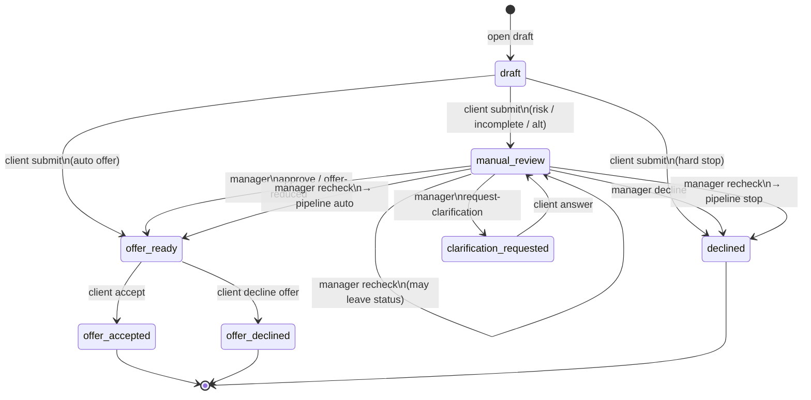

# Диаграмма состояний заявки

Статусы и переходы соответствуют коду (`services/pipeline.py`, `routers/applications.py`, `routers/manager.py`) и contracts §3.

---

## State diagram

Терминалы: `offer_accepted`, `offer_declined`, `declined`.

Недопустимый переход → **409**. Каждое действие пишет запись в `application_events`.

---

## Кто меняет статус

| From | To | Актёр / триггер |
| ---- | -- | --------------- |
| `draft` | `offer_ready` \| `manual_review` \| `declined` | Клиент `submit` → pipeline |
| `manual_review` | `clarification_requested` | Менеджер `request-clarification` |
| `manual_review` | `offer_ready` | Менеджер `approve` или `offer-reduced` |
| `manual_review` | `declined` | Менеджер `decline` (причина ≥3 символов) |
| `manual_review` | (pipeline) | Менеджер `recheck` — attempt++, возможна смена статуса |
| `clarification_requested` | `manual_review` | Клиент `answer` (+ опциональный файл); без авто-recheck |
| `offer_ready` | `offer_accepted` | Клиент `offer/accept` с active `offer_id` |
| `offer_ready` | `offer_declined` | Клиент `offer/decline` с active `offer_id` |

---

## Идемпотентность и инварианты

- `submit` только из `draft`; повтор → 409.
- Один `draft` на клиента на каждый `product_code`.
- Accept/decline offer: `offer_id` должен совпадать с активным предложением.
- Clarification только из `manual_review`; answer только из `clarification_requested`.
- Recheck только из `manual_review`.
- `create_offer` деактивирует предыдущие active offers.
